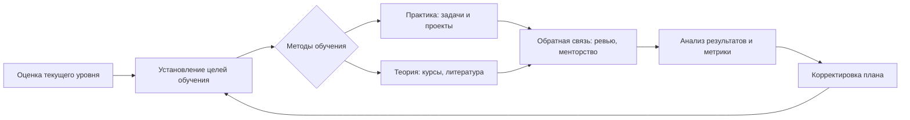

# Исполнительное резюме  
Отчёт анализирует современные представления о сознании и механизмах обучения, чтобы сформировать рекомендации по саморазвитию программиста. В первой части рассматриваются **теории сознания** (философские и нейронаучные): трудная проблема Чалмерса, дуализм/физикализм, теории высшего порядка (метасознания), глобального рабочего пространства, интегрированной информации и прогностической обработки. Во второй части – **психологические механизмы обучения**: метапознание как контроль над собственными мыслями, мотивация (внутренняя/внешняя), осознанная практика (deliberate practice), интервальное повторение и эффективная обратная связь. Третья часть посвящена **когнитивным навыкам программирования**: абстракции и логическому мышлению, отладке (например, «резиновая уточка»), планированию и объёму рабочей памяти, чтению/анализу кода, архитектурному мышлению и рефлексии. Обсуждается, как **модели сознания** указывают на ограничения (например, узкая рабочая память ограничивает сложность одновременно обрабатываемых задач) и подчёркивают роль метапознания (высшие порядки сознания задают необходимость самонаблюдения при обучении). Далее перечислены **практические методы и программы** (целеполагание, планы обучения, проектная работа, code katas, менторинг и т.д.) с доказательной базой (осознанная практика, регулярная обратная связь, «утёнок»-отладка). Анализируются **инструменты** (IDE с поддержкой автодополнения и отладки, трекеры задач, обучающие платформы, AI‑ассистенты) и их влияние: например, AI‑ассистенты (Copilot и др.) могут расширять когнитивные возможности разработчика, создавая синергетический эффект совместно с традиционными методами отладки. Рассматриваются риски (выгорание, когнитивные искажения вроде эффекта Даннинга–Крюгера, ложная компетентность) и предложены **персонализированные планы** развития на краткосрочные (3 мес), среднесрочные (1 год) и долгосрочные (3+ года) периоды с конкретными целями и метриками прогресса.  

## Современные теории строения сознания  
Разные дисциплины предлагают свои модели сознания, на которые опираются практики обучения и саморазвития.  
- **Философские подходы:** определяют сознание как феномен субъективного опыта («какие качественные ощущения испытывает субъект»). «Трудная проблема» сознания (Chalmers) ставит вопрос, как именно нейронные процессы превращаются в субъективный опыт. Идут споры о дуализме (сознание вне физики) vs физикализме (сознание – функция мозга).  
- **Теория высшего порядка:** состояние становится сознательным, когда о нём «знает» более высокий когнитивный процесс (метасознание). Иначе говоря, мысль осознаётся, если есть представление о ней. Эта модель подчёркивает роль пре- и фронтальных отделов мозга в самонаблюдении и планировании.  
- **Глобальное рабочее пространство (GWT):** сознательные состояния «глобально доступны» многим нейронным модулям (памяти, вниманию, языку). Когда сенсорная информация «транслируется» во всё рабочее пространство (главным образом в префронтальную кору), она становится содержанием сознания. Это объясняет, почему сознательный контент может гибко управлять поведением и требовать фокусировки внимания.  
- **Интегрированная информация (IIT):** сознание понимается как уровень интеграции информации в системе. Любая система с ненулевым интегративным информационным «сигналом» Φ обладает сознанием, причём степень сознания пропорциональна Φ. В этой модели сознание связывается с «задней горячей зоной» коры (теменные и затылочные области) и даёт математическое описание субъективности.  
- **Прогностическая обработка:** мозг постоянно строит прогнозы поступающей информации и минимизирует ошибку предсказания. В восприятии сознание возникает при встрече прогнозов с неожиданными данными или сложностями. Такая модель объединяет нейрофизиологию и теории обучения; она связывает сознание с подсознательным выведением вероятных причин ощущений.  

**Таблица 1. Основные теории сознания:** сравнение ключевых подходов.

| Теория (модель) | Ключевая идея | Ключевые авторы |
|---|---|---|
| Высшего порядка (HOT) | Сознательный контент определяется «представлением о нём» более высокого порядка (метасознание) | Розенталь и др. |
| Глобального рабочего пространства (GWT) | Сознание – это глобальная доступность информации широкому нейронному пространству | Баарс (1988); Деан (1990-е) |
| Интегрированной информации (IIT) | Сознание как несократимый интеграл Φ системы; любое максима́льно интегрированное состояние – сознательно | Тонони (2004) и соавт. |
| Прогностическая обработка | Мозг предсказывает сенсорные данные; сознание связано с минимизацией ошибок прогнозов | Фристон (2010-е) и др. |

## Механизмы обучения и саморазвития  
Психология обучения выделяет приёмы, помогающие эффективному усвоению навыков:  
- **Метапознание:** умение «думать о собственном мышлении». Это включает постановку целей, мониторинг понимания и контроль процесса обучения. Успешный учащийся не просто знает «что» (десять сотен), но анализирует свои результаты и активно регулирует стратегию обучения.  
- **Мотивация:** основа любого обучения. Важна внутренняя мотивация (интерес к задаче, смысл) и осознание целей; внешние мотиваторы (награды, среда) лишь дополнение.  
- **Осознанная практика (deliberate practice):** специально спланированные упражнения, нацеленные на улучшение конкретного навыка. По определению Эрикссона, это практики «специально разработанные для повышения текущего уровня» мастерства. Элементами такой практики являются чёткая цель, трудность чуть выше уровня исполнителя, немедленная обратная связь и высокая концентрация.  
- **Интервальное повторение:** запоминание с постепенно увеличивающимися интервалами повторения. Этот научно обоснованный метод улучшает долговременную память и скорость обучения. Новую информацию повторяют через растущие периоды (1 день, 3 дня, 7 дней и т.д.), что многократно увеличивает долю долговременного удержания.  
- **Обратная связь:** ключ для коррекции ошибок и закрепления материала. Качественная обратная связь (от наставников, тестов, коллег) существенно ускоряет обучение и помогает лучше понимать изучаемое. Например, Шут показала, что правильно структурированная обратная связь значительно улучшает результаты учеников.

## Когнитивные навыки, критически важные для программирования  
Важнейшими являются:  
- **Абстрактное мышление:** способность выделять существенные свойства и представлять объекты как абстракции (классы, структуры данных). Без абстракции кодирование превращается в бессмысленную работу с деталями. Развитое абстрактное мышление упрощает дизайн систем и позволяет видеть структурные паттерны.  
- **Логическое мышление:** умение разбивать задачу на этапы и выстраивать причинно-следственные цепочки. В программировании это построение алгоритмов и условий, обеспечение корректности кода.  
- **Рефлексия и анализ:** умение критически оценивать собственную работу и другие решения. Рефлексивное мышление (рефлексия) и обращение внимания на процесс – неотъемлемые части обучения программиста, повышающие качество работы.  
- **Отладка (debugging):** настойчивый логический разбор кода и поиск ошибок. Техники, такие как «резиновая уточка» (объяснение кода самому себе или коллеге), помогают активировать метакогнитивный уровень и часто приводят к инсайту.  
- **Планирование и управление задачами:** способность оценивать масштаб задачи, расставлять приоритеты, дробить работу. Ограниченность рабочей памяти означает, что планирование (упорядочивание нескольких элементов) критически зависит от объёма «ментального рабочего пространства».  
- **Чтение и рефакторинг кода:** понимание чужого кода и умение структурно улучшать существующую программу – ключевой навык.  
- **Архитектурное мышление:** системный взгляд на проект, умение проектировать масштабируемые и гибкие системы. Синтез абстрактного и логического мышления проявляется при архитектурном проектировании – при построении программных систем сложной организации.  

## Модели сознания и самообучение программиста  
Теории сознания подчёркивают и ограничения нашего обучения. Так, **ограниченность рабочего пространства** (GWT) означает, что человек может удерживать в голове лишь несколько объектов одновременно. Это ограничивает сложность одновременно решаемых задач и требует умения разбиения проблемы на части и планирования. Модели **высшего порядка** указывают на важность метапознания: формально мы становимся лучше, когда можем осознавать и контролировать собственный процесс обучения. Теория **прогностической обработки** описывает обучение как постепенное уточнение внутренних моделей мира через ошибки прогнозирования – это соответствует практике исправления кода и поиска новых подходов. Одновременно появляются и ограничения: человеческое сознание склонно к когнитивным искажениям (например, эффект Даннинга–Крюгера при самооценке навыков), а бессознательные процессы (навыки, автоматизация) могут не афишироваться перед сознанием, создавая иллюзию понимания. В целом, современные модели сознания подчёркивают, что эффективное самообучение требует постепенного усложнения задач, постоянной обратной связи и рефлексии.

## Практические методики и программы саморазвития  
Эффективное самообучение программиста опирается на проверенные практики:  
- **Целенаправленная практика:** регулярное решение задач, сфокусированных на слабых местах (алгоритмы, новые языки), с последующей проверкой правильности. Например, использование онлайн-тренажёров задач (Codeforces, LeetCode) с анализом решений.  
- **Проектная работа:** создание собственных небольших проектов и участие в реальных (open source) проектах. Это обеспечивает интеграцию знаний и навыков, а также практическое применение новых инструментов. Важно совмещать проектную работу с обратной связью: например, привлечение ментора или коллег для код-ревью.  
- **Менторинг и сообщество:** регулярные встречи, обмен опытом и code review в группе помогают выявлять ошибки и получать внешнюю оценку. Коллективная отладка и обсуждение решений ускоряют рост навыков.  
- **Методы памяти и времени:** использование интервального повторения при изучении нового (например, программ Anki) помогает надежно запоминать синтаксис и концепции. Техники тайм-менеджмента (Pomodoro, ведение расписания) повышают стабильность обучения.  
- **Метакогнитивные стратегии:** планирование сессии обучения, ведение заметок о целях и итогах, регулярная рефлексия по окончании темы – всё это улучшает осознанность процесса. «Резиновая утка» как практика объяснения кода помогает выявлять пробелы в понимании.  
- **Обучающие программы и курсы:** структурированные курсы (университетские, онлайн-курсы на Coursera, Stepik и т.д.) дают фундамент и примеры лучших практик. Учёба по курсам должна сочетаться с практикой.  

## Инструменты и технологии  
Современные инструменты значительно влияют на обучение и развитие навыков программиста:  
- **IDE и инструменты разработки:** продвинутые IDE (VS Code, IntelliJ IDEA и др.) с автодополнением, подсветкой ошибок и встроенным отладчиком снижают рутинную нагрузку, позволяя фокусироваться на алгоритмах. Визуализация структуры кода (UML, интроспекция) помогает архитектурному мышлению.  
- **Системы управления задачами:** трекеры (Jira, Trello) и доски (Kanban) повышают организованность. Чёткое разделение задач, дедлайны и приоритеты мотивируют к регулярному движению вперёд.  
- **Обучающие платформы:** онлайн-курсы, интерактивные учебники и песочницы (Codecademy, Kaggle, Stepik) структурируют материал и часто используют автоматизированную проверку знаний (quizzes, code grading) для моментальной обратной связи.  
- **AI-ассистенты:** такие, как GitHub Copilot, TabNine и др., могут генерировать фрагменты кода и предлагать решения в реальном времени. Исследования показывают, что интеграция подобных ИИ-инструментов с традиционными методами отладки и обучения создаёт «синергетический эффект», расширяющий когнитивные возможности разработчиков. ИИ способен мгновенно выявлять шаблоны и подсказки в коде, но требует критического контроля и понимания генерируемых предложений.  
- **Средства коллективной работы:** платформы для совместной разработки (Git, GitHub), мессенджеры и форумы помогают обмениваться опытом и получать быстрый фидбэк.  

## Риски и ограничения  
При интенсивном обучении важно учитывать возможные препятствия и искажения:  
- **Выгорание:** постоянный стресс, пропуск отдыха и высокая когнитивная нагрузка могут привести к профессиональному выгоранию. Это снижает память и работоспособность, замедляет обучение. Регулярные перерывы и соблюдение баланса (сна, хобби) обязательны.  
- **Когнитивные искажения:** эффект Даннинга–Крюгера (новички переоценивают навыки) или подтверждающее искажение (ищем лишь подтверждение своих гипотез) могут вводить в заблуждение относительно реального прогресса. Важно периодически проверять знания независимыми тестами и участвовать в командных проверках кода.  
- **Иллюзия компетентности:** поверхностное понимание без глубокого освоения даёт ложное ощущение успеха. Поэтому необходимо чередовать чтение/теорию с практикой и внешней оценкой результатов.  
- **Ограничения моделей сознания:** учитывая ограниченность внимания и памяти, слишком сложные задачи следует дробить на этапы. Также необходимо развивать метапознание, иначе автоматически выполняемые умения не перейдут в сознательный навык.  

## Рекомендации: персонализированный план саморазвития и метрики прогресса  
Саморазвитие программиста требует индивидуального подхода, поэтому план разбивается на этапы:  
- **Краткосрочный (≈3 месяца):** оцените текущий уровень (можно использовать онлайн-тесты или список навыков). Поставьте конкретные цели: выучить основы языка/фреймворка, решить 50 задач базового уровня. Составьте расписание (регулярная практика по 1–2 часа в день). Используйте интервальные повторения (например, Anki) для запоминания терминов, и ежедневные ретроспективы (что получилось, что было сложно). Метрики: число решённых задач, пройденных уроков, пройденных тестов.  
- **Среднесрочный (≈1 год):** переходите к проектам средней сложности: участвуйте в командных или open-source проектах, учитесь работать с git и code review. Расширяйте кругозор: изучайте архитектурные паттерны, читайте код популярных библиотек. Настройте автоматизированное слежение за прогрессом (например, трекер целей или календарь привычек). Метрики: законченные проекты, пулл-реквесты, отзывы коллег, сертификаты или курсы (например, экзамены по уровню знания языка).  
- **Долгосрочный (3+ года):** стремитесь к специализации (например, back-end, data science, DevOps и т.д.) и лидерским качествам. Учите новым программистам (менторство, блоги, выступления на конференциях). Регулярно анализируйте свои метрики: при необходимости корректируйте цели. Метрики долгосрочного успеха могут включать: рост зарплаты, изменение должности (junior → middle/senior), публикации или выступления, вклад в открытое ПО.  

**Ключевые метрики прогресса:** число решённых задач (Codeforces/LeetCode), завершённых проектов, уровень владения технологиями (оценки тестов/сертификаты), внешняя обратная связь (оценка кода, отзывы), а также самочувствие (отсутствие выгорания) и регулярность практики. Постоянная адаптация плана с учётом обратной связи и результатов обеспечит устойчивый рост навыков и компетенций.  

**Источники:** Фундаментальные теории сознания (Baars, Tononi, Friston и др.); исследования метапознания и обучения; практики deliberate practice и «резиновой уточки»; обзоры когнитивных навыков программирования; современные обсуждения AI-инструментов и другие рецензируемые работы.